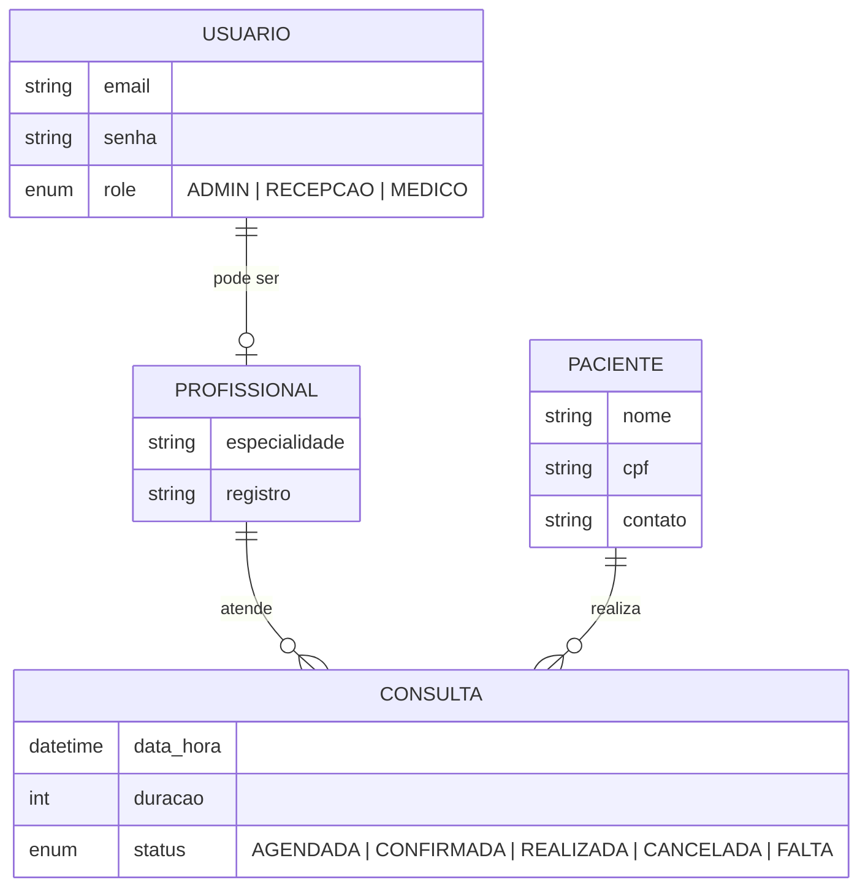

# Clinica App

Sistema web de gestão de clínica médica: agenda por profissional, cadastro de pacientes e controle de consultas, com autenticação e perfis de acesso.


## Sobre o projeto

Clínicas pequenas costumam organizar agenda e pacientes em planilhas, papel e mensagens, o que gera conflitos de horário e perda de informação. O **Clinica App** centraliza esse fluxo: a recepção visualiza a grade de cada profissional, marca, edita e cancela consultas, e acompanha o status de cada atendimento.

O projeto nasceu de um trabalho freelance, do levantamento de requisitos à entrega, e é organizado em API REST e interface web separadas, com ambiente padronizado por Docker.

## Funcionalidades

**Implementado**
- Autenticação com JWT e senhas protegidas com bcrypt
- Perfis de acesso: `ADMIN`, `RECEPCAO` e `MEDICO`
- API REST para profissionais, pacientes e consultas
- Agenda em grade por profissional, com criar, editar e excluir consulta
- Controle de status da consulta: `AGENDADA` · `CONFIRMADA` · `REALIZADA` · `CANCELADA` · `FALTA`
- Banco modelado com Prisma e PostgreSQL, com migrations e seed de dados de teste
- Ambiente completo com Docker Compose

**Em andamento**
- Integração do front-end com as rotas reais (hoje Login e Agenda usam dados mock)
- Tela de pacientes (CRUD)
- Dashboard com indicadores do dia e do mês
- Controle de permissão por perfil no front-end
- Deploy

## Tecnologias

| Camada | Tecnologia |
|---|---|
| Back-end | Node.js, TypeScript, Express |
| ORM e banco | Prisma, PostgreSQL |
| Front-end | React, TypeScript, Vite |
| Autenticação | JWT, bcrypt |
| Infra | Docker, Docker Compose |

## Arquitetura

O back-end é dividido em módulos por domínio (`auth`, `profissionais`, `pacientes`, `consultas`), com middlewares compartilhados para autenticação e tratamento de erros.

```
clinica-app/
├── backend/
│   ├── prisma/
│   │   ├── schema.prisma       # modelo de dados
│   │   └── seed.ts             # dados de teste
│   ├── src/
│   │   ├── modules/            # auth, profissionais, pacientes, consultas
│   │   ├── middlewares/        # auth-guard, error-handler
│   │   ├── config/
│   │   ├── utils/
│   │   ├── app.ts
│   │   └── server.ts
│   ├── Dockerfile
│   └── package.json
├── frontend/
│   ├── src/
│   │   ├── pages/              # Login, Agenda, ...
│   │   └── App.tsx
│   └── package.json
└── docker-compose.yml
```

### Modelo de dados



## Como executar

### Com Docker (recomendado)

```bash
docker-compose up --build
```

Sobe PostgreSQL, back-end e front-end juntos. Em seguida, aplique a migration e o seed no container do back-end:

```bash
docker-compose exec backend npx prisma migrate deploy
docker-compose exec backend npm run seed
```

### Local (sem Docker)

**Back-end**

```bash
cd backend
cp .env.example .env        # ajuste DATABASE_URL e JWT_SECRET
npm install
npx prisma migrate dev --name init
npm run seed                # cria admin e 3 profissionais de teste
npm run dev                 # http://localhost:3000
```

**Front-end**

```bash
cd frontend
npm install
npm run dev                 # http://localhost:5173
```

### Variáveis de ambiente

| Variável | Descrição |
|---|---|
| `DATABASE_URL` | String de conexão do PostgreSQL |
| `JWT_SECRET` | Segredo usado para assinar os tokens JWT |

### Login de teste

Disponível apenas com os dados do seed, para ambiente de desenvolvimento:

```
email: admin@clinica.com
senha: 123456
```

## API

Rotas protegidas exigem o header `Authorization: Bearer <token>`.

| Método | Rota | Auth | Descrição |
|---|---|---|---|
| POST | `/api/auth/login` | Não | Login, retorna JWT |
| GET | `/api/profissionais` | Sim | Lista profissionais |
| GET | `/api/pacientes?busca=` | Sim | Busca pacientes |
| POST | `/api/pacientes` | Sim | Cria paciente |
| GET | `/api/consultas?data=YYYY-MM-DD` | Sim | Consultas do dia |
| POST | `/api/consultas` | Sim | Cria consulta |
| PUT | `/api/consultas/:id` | Sim | Edita consulta |
| DELETE | `/api/consultas/:id` | Sim | Exclui consulta |

Exemplo de login:

```bash
curl -X POST http://localhost:3000/api/auth/login \
  -H "Content-Type: application/json" \
  -d '{"email":"admin@clinica.com","senha":"123456"}'
```

## Roadmap

- [x] Tela de login (React + TypeScript)
- [x] Tela de agenda com grade por profissional
- [x] Back-end: auth, profissionais, pacientes e consultas
- [x] Banco modelado com Prisma e PostgreSQL
- [x] Docker
- [ ] Conectar front-end às rotas reais
- [ ] Tela de pacientes (CRUD)
- [ ] Dashboard de indicadores
- [ ] Permissões por perfil no front-end
- [ ] Deploy

## Autor

**Thiago Sousa** — Estudante de Ciência da Computação (UFMA)

[GitHub](https://github.com/tpsousa) · [LinkedIn](https://www.linkedin.com/in/tpsousa-) · [Portfólio](https://portifolio-thiago-sousa.vercel.app/)
